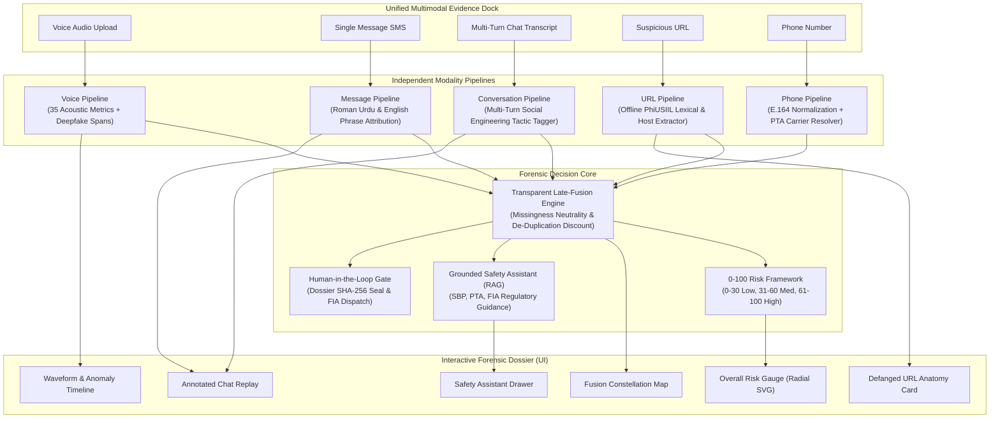

# Multimodal Impersonation & Fraud Analyzer (AegisAI / Sentinel Core)

> **Flagship Cyber-Forensic Command Center & Multimodal Impersonation Risk Analyzer**  
> Analyzing Voice, Conversation, Message, URL, and Phone Number Evidence with Explainable Late-Fusion.

[](docs/SRS_Final.md)
[](https://github.com/maryam441/Multimodal-Impersonation-and-Fraud-Analyzer/tree/staging)
[](https://www.python.org/)
[](https://fastapi.tiangolo.com/)
[](https://nextjs.org/)
[](LICENSE)

---

## 1. System Architecture



---

## 2. Milestone Execution Log (M00 — M17)

All 18 engineering milestones have been completed, verified with automated tests, and merged into `staging`:

| Milestone | Scope & Deliverables | Integration Branch | Status |
|---|---|---|:---:|
| **M00** | Repository audit, safe git baseline, `.gitignore`, `.env.example` | `feature/M00-repository-audit` | **Completed** |
| **M01** | Technical decisions & system architecture (`ARCHITECTURE.md`) | `feature/M01-technical-decisions` | **Completed** |
| **M02** | Dataset discovery, audit, and manifests (`DATASETS.md`) | `feature/M02-dataset-discovery` | **Completed** |
| **M03** | FastAPI foundation, Docker setup, CI workflow, health check | `feature/M03-project-foundation` | **Completed** |
| **M04** | Async SQLite DB, case TTL lifecycle, smart entity extraction | `feature/M04-backend-core` | **Completed** |
| **M05** | Next.js 15 App Router frontend, Tailwind CSS, dark cyber-theme | `feature/M05-frontend-foundation` | **Completed** |
| **M06** | 5 Studio cards, interactive waveform preview, smart extraction chips | `feature/M06-evidence-studio-workflows` | **Completed** |
| **M07** | Standardized BaseModalityAnalyzer contract & pipeline telemetry | `feature/M07-job-orchestration` | **Completed** |
| **M08** | Voice pipeline: 35 acoustic metrics + temporal anomaly detector | `feature/M08-voice-pipeline` | **Completed** |
| **M09** | Message pipeline: Roman Urdu & English phrase attribution | `feature/M09-message-pipeline` | **Completed** |
| **M10** | Conversation pipeline: Multi-turn tactic tagger & escalation velocity | `feature/M10-conversation-pipeline` | **Completed** |
| **M11** | URL pipeline: Offline PhiUSIIL lexical extractor & defanging | `feature/M11-url-pipeline` | **Completed** |
| **M12** | Phone pipeline: E.164 normalization & cautious fallback adapter | `feature/M12-phone-pipeline` | **Completed** |
| **M13** | Fusion engine: Missingness neutrality, ablation, and divergence checks | `feature/M13-fusion-engine` | **Completed** |
| **M14** | Grounded Safety Assistant (RAG) & Human-in-the-Loop gate | `feature/M14-rag-explainability` | **Completed** |
| **M15** | Interactive Forensic Dossier: Risk Gauge, Constellation, Replay | `feature/M15-forensic-dossier-frontend` | **Completed** |
| **M16** | Security audit (SSRF, XSS, Secret leak check) & E2E evaluation | `feature/M16-security-qa-eval` | **Completed** |
| **M17** | Release Candidate v3.0.0-rc1, deployment guide & documentation | `feature/M17-release-candidate` | **Completed** |

---

## 3. Model Cards & Architectural Specifications

Detailed behavioral cards, limitations, and evaluation metrics:
- 🎙️ **Voice Modality:** [`docs/MODEL_CARDS/VOICE_MODEL_CARD.md`](docs/MODEL_CARDS/VOICE_MODEL_CARD.md)
- 💬 **Single Message Modality:** [`docs/MODEL_CARDS/MESSAGE_MODEL_CARD.md`](docs/MODEL_CARDS/MESSAGE_MODEL_CARD.md)
- 👥 **Multi-Turn Conversation Modality:** [`docs/MODEL_CARDS/CONVERSATION_MODEL_CARD.md`](docs/MODEL_CARDS/CONVERSATION_MODEL_CARD.md)
- 🌐 **URL & Domain Modality:** [`docs/MODEL_CARDS/URL_MODEL_CARD.md`](docs/MODEL_CARDS/URL_MODEL_CARD.md)
- 📞 **Phone Number Modality:** [`docs/MODEL_CARDS/PHONE_MODEL_CARD.md`](docs/MODEL_CARDS/PHONE_MODEL_CARD.md)
- ⚖️ **Multimodal Fusion Engine:** [`docs/MODEL_CARDS/FUSION_ENGINE_CARD.md`](docs/MODEL_CARDS/FUSION_ENGINE_CARD.md)
- 🤖 **Grounded RAG Safety Assistant:** [`docs/MODEL_CARDS/RAG_ASSISTANT_CARD.md`](docs/MODEL_CARDS/RAG_ASSISTANT_CARD.md)
- 📊 **Research Evaluation Report:** [`docs/RESEARCH_EVALUATION.md`](docs/RESEARCH_EVALUATION.md)

---

## 4. Quickstart Setup & Execution

### Option A: Local Development Setup

#### 1. Backend (Python 3.12)
```bash
# From workspace root
pip install -r requirements.txt

# Start FastAPI asynchronous API server
uvicorn backend.app.main:app --reload --host 0.0.0.0 --port 8000
```
- API Documentation (Swagger): `http://localhost:8000/api/v1/docs`
- Health Telemetry: `http://localhost:8000/api/v1/health`

#### 2. Frontend (Next.js 15)
```bash
cd frontend
npm install
npm run dev
```
- Forensic Command Center UI: `http://localhost:3000`

---

### Option B: Docker Compose Deployment

```bash
# Build and run backend, frontend, and volumes
docker-compose up --build
```
Access the application at `http://localhost:3000`.

---

## 5. Automated Verification Suite

Run all 36 unit, integration, SSRF defense, and lifecycle tests:
```bash
python -m pytest backend/tests/ -v
```
Build Next.js production bundle:
```bash
cd frontend && npm run build
```

---

## 6. Ethical Boundary Charter & Decision-Support Mandate

1. **Zero Hallucination:** The Grounded Assistant references strictly deterministic model outputs and official statutory circulars (SBP BPRD Circular 02/2023, PTA Shortcode 8866, PECA 2016 Sections 13 & 14).
2. **Missingness Neutrality:** Missing modalities are never imputed as zero risk; they are excluded from the denominator ($w_i = 0$ for unprovided) to avoid false-negative dilution.
3. **SSRF & Execution Defense:** URLs are defanged (`hxxp://`, `[.]`) and evaluated purely via static lexical/host parsing without live HTTP network crawling.
4. **Human-in-the-Loop Gate:** High-consequence actions (e.g. FIA incident reporting) strictly require explicit human investigator authorization before dispatch.
