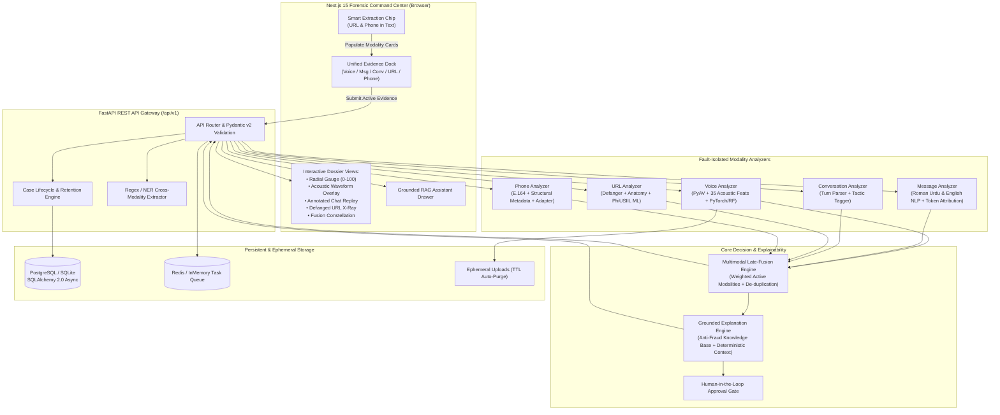

# System Architecture & Technical Design Specification
**Project:** Multimodal Impersonation & Fraud Analyzer (AegisAI / Sentinel Core)  
**SRS Version:** 3.0 (Enterprise & High-Innovation Edition)  
**Document Version:** 1.0  
**Status:** Approved Architectural Baseline (Milestone M01)  
**Target Integration Branch:** `staging`  

---

## 1. Architectural Vision & Core Principles

The **Multimodal Impersonation & Fraud Analyzer** is engineered as a flagship **Cyber-Forensic Command Center** for analyzing suspicious communication evidence across five independent modalities: **Voice, Conversation, Message, URL, and Phone Number**.

### 1.1 Guiding Architectural Principles
1. **Decision-Support, Never Absolute Proof:** The system explicitly communicates uncertainty and risk indicators. It never asserts that a person has been definitively proven fraudulent.
2. **Deterministic Source of Truth:** Modality classifiers, feature extractors, and the late-fusion mathematical engine produce all risk scores. An LLM layer is strictly for plain-language explanation and guided safety advice grounded in deterministic output; it can never alter scores or fabricate evidence.
3. **No Unjustified Imputation (Missingness Safety):** An omitted modality is never assumed to be "safe" or scored as 0 risk. Missing modalities are visually and mathematically isolated as *Not Evaluated / Neutral*.
4. **Fault-Isolated Modality Pipelines:** A timeout, parse error, or corruption in one modality (e.g., an unreadable audio file) must never fail the entire analysis case. Active modalities continue to process and fuse cleanly.
5. **Human-in-the-Loop Gate:** Any proposed action involving external third-party lookups, paid APIs, live URL fetches, or reporting requires explicit user consent via an interactive confirmation modal.
6. **Privacy by Design & Ephemeral Retention:** Raw audio files and sensitive message contents are processed ephemerally, protected by a configurable TTL (default 24 hours), and purgeable instantly on user demand.

---

## 2. High-Level Architecture Diagram



---

## 3. Technology Stack Selection & Justification

| Architectural Layer | Selected Technology | Version | Rationale & Justification |
|---|---|---|---|
| **Frontend Framework** | **Next.js (App Router)** | `15.x` | Server/Client hybrid architecture, high SEO/performance, native React 19 support, strict TypeScript typing. |
| **Language (Web)** | **TypeScript** | `5.x` | Complete end-to-end type safety sharing data contracts with backend Pydantic schemas. |
| **Styling & Design System** | **Tailwind CSS + shadcn/ui** | `v4 / latest` | Precision dark-mode "Forensic Studio" styling, Radix UI accessible headless primitives, zero runtime CSS overhead. |
| **Animation & Motion** | **Framer Motion** | `12.x` | Physics-based spring animations for expandable evidence drawers, radial meter reveals, and constellation transitions. |
| **Forensic Visualizations** | **Web Audio API + Canvas + SVG** | Native / Recharts | Client-side real-time audio waveform scrubbing, temporal anomaly overlays, and interactive fusion graphs. |
| **Backend Framework** | **Python FastAPI** | `0.143+` | High-throughput asynchronous Python web framework, automatic OpenAPI documentation, native Pydantic v2 integration. |
| **Validation Layer** | **Pydantic v2** | `2.14+` | High-performance C-based schema validation for all API inputs and modality response contracts. |
| **ORM & Database** | **SQLAlchemy 2.0 (Async) + Alembic** | `2.1+` | Enterprise async database access with seamless dialect switching between SQLite (local dev) and PostgreSQL (production). |
| **Task Orchestration** | **Asyncio Background Tasks / Redis** | `native / 7.x` | Non-blocking execution of long-running audio/model inference with granular job status streaming. |
| **ML & Signal Processing** | **Scikit-learn, NumPy, SciPy, PyAV** | `1.9+, 2.4+, 17.0+` | Rock-solid, reproducible acoustic feature extraction (MFCCs, spectral, jitter, shimmer) and tabular ML classifiers. |
| **Deep Learning** | **PyTorch + Torchaudio** | `2.15+` | Voice deepfake/spoof anomaly detection and representation learning. |
| **Testing Harness** | **Pytest + Vitest / Playwright** | `9.1+` | Comprehensive unit, integration, boundary, and browser E2E test coverage across all five modalities. |

---

## 4. Frontend UX Architecture & Five Flagship Innovations

The user interface implements the **"Forensic Precision"** design philosophy (supporting both Daylight Slate and Obsidian Forensic dark modes), featuring five signature interactive innovations:

### 4.1 Innovation 1: Unified Evidence Dock & Smart Cross-Modality Extraction
- Instead of five disjoint pages, a unified command center provides a single workspace with five toggleable modality cards.
- **Smart Extraction:** When a user pastes a message or multi-turn chat containing a link (e.g., `bit.ly/bank-alert`) or phone number (`0300-1234567`), the frontend detects the entity and displays a one-click chip:
  `[⚡ Extract & Analyze URL: bit.ly/bank-alert]` or `[⚡ Extract & Analyze Number: +92 300 1234567]`.
- Clicking the chip automatically populates and activates the corresponding modality card (with explicit user consent).

### 4.2 Innovation 2: Interactive Acoustic Waveform & Temporal Anomaly Overlay
- Uploaded voice recordings are decoded client-side using Web Audio / Canvas APIs to display an interactive waveform.
- When model inference completes, temporal anomaly markers (segments with high acoustic perturbation, jitter, or synthetic artifact signatures) are rendered directly onto the audio timeline. Users can scrub and listen to the suspicious intervals.

### 4.3 Innovation 3: Annotated Chat-Thread & Tactic Highlighter
- Multi-turn pasted conversations are transformed into an interactive Chat Replay.
- Detected social-engineering tactics are highlighted turn-by-turn with color-coded badges:
  - `[Urgency & Pressure]` (Amber)
  - `[Authority / Police / Bank Impersonation]` (Crimson)
  - `[OTP / Credential Solicitation]` (Crimson)
  - `[Platform Migration / Channel Switch]` (Purple)
- Clicking a highlight displays a popover explaining the psychological manipulation pattern.

### 4.4 Innovation 4: Safe Defanged URL Anatomy X-Ray
- User-submitted URLs are immediately defanged in the UI (`hxxps://bank-verify[.]pk/login`) to prevent accidental clicks.
- The URL is decomposed into an interactive structural anatomy breakdown:
  - Protocol (`https`), Subdomains (`security.login`), Root Domain (`bank-verify`), TLD (`.pk`), Path & Query Parameters (`/auth?token=...`).
  - Flagged lexical anomalies (typosquatting, high Shannon entropy, IP-in-host, deceptive keyword embedding) are visually pinpointed.

### 4.5 Innovation 5: Multimodal Fusion Constellation & Grounded AI Safety Assistant
- **Overall Risk Gauge (0–100):** Visualized as a precision radial gauge with crisp semantic boundaries:
  - `0–30`: **Low Risk** (Emerald)
  - `31–60`: **Medium Risk** (Amber)
  - `61–100`: **High Risk** (Crimson)
  - **Inconclusive:** Displayed when evidence is insufficient, contradictory, or corrupted.
- **Fusion Constellation:** A node-graph visualizing active modalities, their relative mathematical weights, and explicitly rendering unprovided modalities as `"Not Evaluated (Neutral)"`.
- **Grounded AI Safety Assistant (RAG):** Docked right-hand panel answering questions (e.g., *"What should I do if I shared my OTP?"*) grounded strictly in anti-fraud knowledge and deterministic case evidence, with source badges.

---

## 5. Five Independent Modality Analyzers Specification

Every modality analyzer adheres to a strict abstract service contract (`BaseModalityAnalyzer`) returning a standardized `ModalityResultSchema`.

### 5.1 Voice Modality Analyzer (`voice`)
- **Input:** Audio file (`.wav`, `.mp3`, `.ogg`, `.flac`, `.m4a`).
- **Validation:** Magic-byte inspection, duration (1s – 180s), sample rate resampling to 16 kHz mono float32.
- **Feature Extraction (35 Acoustic Metrics):**
  - MFCCs (13 means + 13 standard deviations)
  - Spectral descriptors (centroid, bandwidth, rolloff, flatness)
  - Temporal descriptors (RMS energy, Zero-Crossing Rate)
  - Stress & Perturbation descriptors (Pitch $F_0$, Jitter, Shimmer)
- **Model:** Random Forest acoustic classifier baseline + PyTorch deep-learning spoof model.
- **Output:** Risk score (0–100), classification (`ham` / `spam` / `inconclusive`), key acoustic metrics, explainable indicators, and temporal anomaly timestamps.

### 5.2 Message Modality Analyzer (`message`)
- **Input:** Single text string (SMS, WhatsApp, email snippet).
- **Language Support:** English and Roman Urdu (evaluated and calibrated against `Dataset_5971.csv`).
- **Pipeline:** Preprocessing (URL/phone extraction, case normalization, punctuation filtering, phonetic mapping for Roman Urdu) + TF-IDF vectorization with Linear SVM / Logistic Regression classifier.
- **Attribution Engine:** Extracts token-level and n-gram feature weights to identify exact suspicious character spans (`start`, `end`, `token`, `weight`).
- **Output:** Risk score, classification, highlighted trigger spans, and detected scam category (e.g., *Bank OTP, Prize/Lottery, Emergency Fund*).

### 5.3 Conversation Modality Analyzer (`conversation`)
- **Input:** Multi-turn text formatted as `Sender: ...` / `Recipient: ...` or raw pasted dialogue.
- **Turn Parser:** Splits into chronological turns, extracts speaker roles, and preserves conversation flow.
- **Tactic Analyzer:** Multi-label pattern engine detecting escalation, authority claims, artificial urgency, and financial pressure.
- **Output:** Risk score, escalation profile, turn-by-turn annotated tactics with character offsets and explanations.

### 5.4 URL Modality Analyzer (`url`)
- **Input:** URL string.
- **Safe Handling:** Client & server defanging (`hxxp://`, `[.]`), strictly avoiding live outbound network requests by default.
- **Feature Extraction:** 24 lexical and host-based metrics (URL length, domain length, Shannon entropy, dot count, subdomain count, hyphen count, IP address host check, suspicious keyword match, suspicious TLD score).
- **Model:** Gradient Boosting / Random Forest classifier trained on the PhiUSIIL academic benchmark dataset.
- **Output:** Risk score, classification (`benign_likely`, `phishing_likely`, `inconclusive`), structural anatomy breakdown, and flagged risk tokens.

### 5.5 Phone Modality Analyzer (`phone`)
- **Input:** Raw phone number string with optional dial code.
- **Validation & Normalization:** Strict E.164 normalization via `phonenumbers` library, supporting Pakistan (`+92`) and international standards.
- **Structural Metadata:** Extracts country, region, carrier identification, and line type (mobile vs. fixed line vs. VoIP) where lawful.
- **Reputation Adapter:** Connects to configured reputation providers. When no verified data exists, transparently returns status `insufficient_data` or `unavailable`. It **never** fabricates a safe or fraudulent verdict based on synthetic data.

---

## 6. Multimodal Fusion Engine & Risk Framework

### 6.1 Transparent Weighted Late-Fusion Baseline
Let $M = \{m_1, m_2, \dots, m_k\}$ be the set of active modalities for a given case where $k \in [1, 5]$.
Each active modality $m_i$ produces an individual risk score $S_i \in [0, 100]$ and has a calibrated base weight $w_i > 0$.

The overall fused risk score $R_{fused}$ is calculated as:
$$R_{fused} = \frac{\sum_{i \in M} w_i \cdot S_i}{\sum_{i \in M} w_i}$$

### 6.2 Missing Modality & Inconclusive Rules
- **Missing Modality:** If a modality $m_j \notin M$, its weight $w_j = 0$. Missing modalities are strictly excluded from the denominator. They are never imputed as zero risk.
- **Inconclusive Modality:** If an active modality returns status `inconclusive` (e.g. noisy audio or unsupported format), it is excluded from the numerical weighted sum and recorded in the report as `inconclusive_modalities`.
- **Global Inconclusive Verdict:** If all active modalities return `inconclusive`, or if phone reputation is the sole modality and returns `insufficient_data`, the global assessment is explicitly set to `Inconclusive` with reasons, suppressing numerical score display.

### 6.3 Cross-Modal Correlation De-duplication
When a URL or phone number is extracted directly from a submitted message or conversation, the URL/phone signal is correlated with the text signal.
To prevent double-counting:
- If both Message and URL are active, and the URL was embedded in the Message, the URL modality weight is dampened by a correlation discount factor $\delta = 0.75$.

### 6.4 Risk Categories & Boundary Definitions
| Score Range | Category | Color Semantic | System Guidance |
|---|---|---|---|
| **0 – 30** | **Low Risk** | Emerald (`#10b981`) | Evidence matches typical legitimate communication. Standard vigilance advised. |
| **31 – 60** | **Medium Risk** | Amber (`#f59e0b`) | Suspicious indicators detected (e.g. urgency or unverified links). Independent verification recommended. |
| **61 – 100** | **High Risk** | Crimson (`#ef4444`) | Severe fraud/impersonation signatures detected. Do not share OTPs, money, or credentials. |

*Exact boundary tests:* Scores of 30 vs 31 and 60 vs 61 are strictly unit-tested.

---

## 7. Grounded RAG & Safety Assistant Specification

The explainability layer assists users by translating deterministic technical signals into actionable safety steps without ever mutating model findings:

1. **Curated Knowledge Base:** Anti-fraud guidance from trusted public authorities (PTA, State Bank of Pakistan, FIA Cybercrime Wing, CISA, FTC).
2. **Context Grounding:** The RAG prompt is supplied with:
   - Fused risk score and category
   - Per-modality active findings and extracted spans
   - Exact limitations and uncertainty disclaimers
3. **Guardrails:**
   - The assistant is forbidden from guessing caller identity.
   - It cannot declare an item "guaranteed safe" or "100% fake".
   - If offline or LLM API keys are unconfigured, a deterministic rule-based playbook generator executes seamlessly as a zero-failure fallback.

---

## 8. Ephemeral Data Lifecycle & Retention Architecture

```
User Evidence Submission
    │
    ▼
FastAPI Case Creation (Case ID: UUID4)
    │
    ├── Temp File Storage (uploads/UUID/) ──► Processed in Memory
    │
    ├── Structured Metadata & Results ──────► PostgreSQL / SQLite
    │
    ▼
Analysis Completed & Dossier Rendered
    │
    ├── Option A: User Clicks "Purge Case Now" ──► Instant Hard Deletion of Files & DB Records
    │
    └── Option B: TTL Expiration (24h Default) ──► Scheduled Cleanup Purges Files & Anonymizes Data
```

- **Zero Permanent Raw Storage:** Raw audio recordings and message texts are never retained indefinitely.
- **Cryptographic Case Token:** Guest users receive a cryptographically random session token to view/purge their own case dossier without creating an account.

---

## 9. Comprehensive REST API Contract (`/api/v1`)

```text
# System Health & Telemetry
GET    /api/v1/health
GET    /api/v1/models
GET    /api/v1/providers/status

# Case Lifecycle
POST   /api/v1/cases                           # Create new case
GET    /api/v1/cases/{case_id}                 # Get case status & summary
DELETE /api/v1/cases/{case_id}                 # Instant hard purge of case and evidence

# Smart Cross-Modality Extraction
POST   /api/v1/cases/{case_id}/extract         # Auto-extract URLs & phone numbers from text

# Modality Analysis Endpoints
POST   /api/v1/cases/{case_id}/phone           # Submit & analyze phone number
POST   /api/v1/cases/{case_id}/voice           # Upload & analyze audio recording (multipart)
POST   /api/v1/cases/{case_id}/conversation    # Submit & analyze multi-turn conversation
POST   /api/v1/cases/{case_id}/message         # Submit & analyze single message
POST   /api/v1/cases/{case_id}/url             # Submit & analyze URL string

# Case Synthesis & Dossier
GET    /api/v1/cases/{case_id}/report          # Retrieve full forensic dossier & fusion result
POST   /api/v1/cases/{case_id}/explain         # Grounded RAG follow-up Q&A
```

---

## 10. Database Schema (SQLAlchemy 2.0 Async)

The normalized relational schema is structured into five core tables:

1. **`cases`:**
   - `id`: UUID (Primary Key)
   - `client_token`: String (Indexed; for guest case authorization)
   - `status`: Enum (`created`, `processing`, `completed`, `failed`)
   - `created_at`: DateTime (UTC)
   - `expires_at`: DateTime (UTC; retention TTL)
2. **`modality_results`:**
   - `id`: UUID (Primary Key)
   - `case_id`: UUID (Foreign Key $\rightarrow$ `cases.id`)
   - `modality`: Enum (`voice`, `conversation`, `message`, `url`, `phone`)
   - `status`: Enum (`analyzed`, `inconclusive`, `failed`, `insufficient_data`)
   - `risk_score`: Float (Nullable; 0.0 – 100.0)
   - `risk_label`: Enum (`low`, `medium`, `high`, `inconclusive`)
   - `confidence`: Float (Nullable; calibrated only when valid)
   - `signals`: JSONB / JSON (Structured evidence items with spans/timestamps)
   - `metrics`: JSONB / JSON (Modality-specific features, e.g., acoustic metrics or URL tokens)
   - `model_info`: JSONB / JSON (Model name, architecture, version)
   - `limitations`: JSONB / JSON (Array of uncertainty strings)
   - `processing_ms`: Integer
   - `created_at`: DateTime (UTC)
3. **`fusion_assessments`:**
   - `id`: UUID (Primary Key)
   - `case_id`: UUID (Unique Foreign Key $\rightarrow$ `cases.id`)
   - `fused_score`: Float (Nullable; 0.0 – 100.0)
   - `risk_category`: Enum (`low`, `medium`, `high`, `inconclusive`)
   - `status`: Enum (`evaluated`, `inconclusive`)
   - `active_modalities`: JSONB / JSON (List of analyzed modalities)
   - `missing_modalities`: JSONB / JSON (List of unprovided modalities)
   - `weights_applied`: JSONB / JSON (Modality weights and correlation adjustments)
   - `rationale`: Text (Mathematical breakdown of fusion decision)
   - `created_at`: DateTime (UTC)
4. **`audit_events`:**
   - `id`: UUID (Primary Key)
   - `case_id`: UUID (Foreign Key $\rightarrow$ `cases.id`)
   - `action`: String (e.g., `case_created`, `modality_analyzed`, `case_purged`)
   - `timestamp`: DateTime (UTC)
5. **`provider_checks`:**
   - `id`: UUID (Primary Key)
   - `provider_name`: String
   - `status`: Enum (`online`, `degraded`, `offline`, `unconfigured`)
   - `last_checked_at`: DateTime (UTC)

---

## 11. Milestone Alignment & Execution Protocol

This architectural baseline directly governs implementation across subsequent milestones:
- **M02:** Formalize dataset register, gap analysis, and manifests for Voice, Message, URL, Phone, and Conversation.
- **M03:** Establish project foundation, monorepo/folder layout, shared schemas, and Docker Compose developer experience.
- **M04:** Implement FastAPI core, SQLAlchemy async database, migrations, and case lifecycle endpoints.
- **M05 & M06:** Build Next.js App Router frontend, "Forensic Precision" design system, Evidence Dock, and all 5 input cards.
- **M07 – M12:** Implement the 5 independent modality pipelines with clean ML adapters.
- **M13 – M15:** Deliver late-fusion engine, grounded RAG assistant, and full interactive forensic dossier.
- **M16 & M17:** Rigorous security, QA, evaluation benchmarking, and final release candidate.
