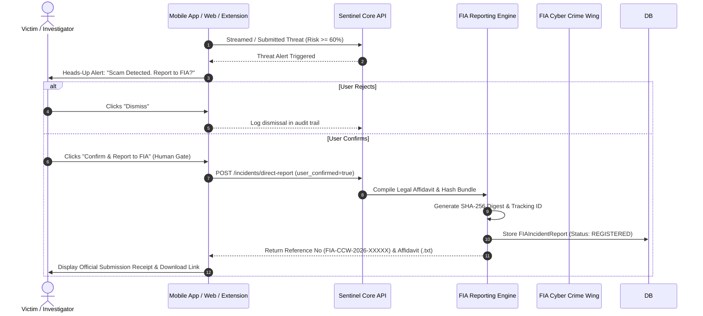

# System Architecture & Technical Design Specification
## Cross-Platform Real-Time Anti-Fraud & Law Enforcement Defense
**Project:** Multimodal Impersonation & Fraud Analyzer (Sentinel Core / AegisAI)  
**SRS Version:** 4.0 (Enterprise Cross-Platform Web + Mobile Edition)  
**Document Version:** 2.0  
**Status:** Approved Architectural Specification (Milestone M01)  
**Target Integration Branch:** `staging`  

---

## 1. Architectural Vision & Core Principles

The **Multimodal Impersonation & Fraud Analyzer** is engineered as a unified **Cross-Platform Anti-Fraud & Cybersecurity Defense Ecosystem** operating simultaneously across Web, Mobile, Browser, and Desktop environments.

```mermaid
flowchart TD
    subgraph Clients["Cross-Platform Client Ecosystem"]
        Web["Next.js 15 Web Command Center<br>(Forensic Workspace & Generative UI)"]
        Mobile["React Native / Expo Mobile App<br>(Notification Listener & Heads-Up Overlay)"]
        Ext["Chrome / Edge Ambient Extension<br>(WhatsApp Web & Gmail Inline Shields)"]
        Desktop["Desktop Clipboard Daemon<br>(Windows Native System Toast Alerts)"]
    end

    subgraph Gateway["FastAPI Async Gateway & Telemetry"]
        REST["REST API Router (/api/v1)"]
        WS["WebSocket Streaming Hub (/api/v1/stream/live)"]
        Auth["Case Lifecycle & Ephemeral TTL Engine"]
        SmartExtract["Smart Entity Extractor (URLs & Phones)"]
    end

    subgraph Pipeline["6 Fault-Isolated Modality Analyzers"]
        VoiceA["1. Voice Analyzer<br>(PyTorch Acoustic + 35 Feats + Streaming Chunks)"]
        MsgA["2. Single Message Analyzer<br>(Roman Urdu & English NLP + Attribution)"]
        ConvA["3. Conversation Analyzer<br>(Multi-Turn Tactic Tagger + Escalation)"]
        URLA["4. URL Analyzer<br>(Offline PhiUSIIL Lexical Features + Defanger)"]
        PhoneA["5. Phone Analyzer<br>(E.164 + PTA Carrier Resolver + Fallback)"]
        EmailA["6. Email Analyzer<br>(RFC Header Spoof + SPF/DKIM/DMARC + Body Phishing)"]
    end

    subgraph Decision["Core Decision & Law Enforcement Engine"]
        Fusion["Multimodal Late-Fusion Engine<br>(Weighted Scores + Redundancy Discount δ=0.75)"]
        RAG["Grounded Safety Assistant<br>(SBP / PTA / FIA Regulatory Advice)"]
        FIA["Autonomous FIA Reporting Agent<br>(Strict Human-in-the-Loop Confirmation Gate)"]
    end

    subgraph Storage["Persistence & Integrity Vault"]
        DB[(SQLAlchemy Async<br>SQLite / PostgreSQL)]
        Vault["Tamper-Evident Dossier Vault<br>(SHA-256 Sealed Records)"]
    end

    Clients <--> Gateway
    Gateway --> Pipeline
    Pipeline --> Decision
    Decision --> Storage
```



---

## 2. Real-Time Streaming WebSocket Protocol (`/api/v1/stream/live`)

To power real-time in-conversation threat detection on the installable mobile companion app and desktop watcher, the backend exposes a bidirectional WebSocket endpoint:

$$\text{Endpoint: } \texttt{ws://localhost:8000/api/v1/stream/live}$$

### 2.1 Message Framing Specification

#### Client to Server: Stream Chunks
```json
{
  "event": "chunk_ingest",
  "session_id": "9b1deb4d-3b7d-4bad-9bdd-2b0d7b3dcb6d",
  "modality": "audio" | "conversation" | "email",
  "timestamp": 1700000000.123,
  "payload": {
    "audio_pcm_base64": "...", // If audio: 16kHz 16-bit mono PCM (1-2s chunk)
    "speaker": "Caller",        // If conversation
    "text_delta": "...",        // Incremental text or speech-to-text token
    "sender": "+923001234567"
  }
}
```

#### Server to Client: Live Threat Telemetry
```json
{
  "event": "threat_update",
  "session_id": "9b1deb4d-3b7d-4bad-9bdd-2b0d7b3dcb6d",
  "fused_score": 78.5,
  "risk_category": "high",
  "is_threat": true,
  "trigger_heads_up_overlay": true,
  "threat_tags": ["Bank Impersonation", "Urgency Spike", "Synthetic Voice Discontinuity"],
  "active_modalities": ["voice", "conversation"],
  "recommended_action": "WARN_AND_OFFER_FIA_REPORT",
  "latency_ms": 38
}
```

---

## 3. The 6-Modality Analytical Architecture

| # | Modality | Primary Engine | Threat Signals Extracted | Cautious Policy / Safeguard |
|---|---|---|---|---|
| 1 | **Voice** | PyTorch / Librosa 35 Acoustic Metrics | Pitch F0 mean/std, jitter, shimmer, spectral centroid, deepfake discontinuity segments | Batch files or live PCM audio chunks |
| 2 | **Single Message** | Roman Urdu & English NLP Classifier | Bank freeze threats, fake lottery claims, OTP theft tokens | Regex phrase attribution spans |
| 3 | **Conversation** | Multi-Turn Dialogue Parser | Authority impersonation, artificial urgency, platform migration, coercive payment | Escalation velocity tracker |
| 4 | **URL** | Static Lexical & Host Extractor | Deceptive tokens, hyphen counts, suspicious TLDs, IP hosts | Zero live crawling (SSRF defense), automatic defanging (`hxxp://`) |
| 5 | **Phone** | E.164 Normalizer & PTA Carrier Resolver | Jazz, Zong, Ufone, Telenor, SCOM identification, known scam fixtures | SRS §15.5 mandate: `insufficient_data` for unverified numbers |
| 6 | **Email** | RFC Header & Phishing Body Analyzer | SPF/DKIM/DMARC alignment failure, display-name spoofing, fake invoice / account suspension | Inspects sender headers and body without downloading attachments |

---

## 4. Autonomous FIA Cybercrime Reporting Agent (PECA 2016)



---

## 5. Late Fusion & Mathematical Formulation

The overall calibrated risk score $S_{\text{fused}} \in [0, 100]$ is computed as:

$$S_{\text{fused}} = \frac{\sum_{i \in \mathcal{A}} w_i \cdot S_i}{\sum_{i \in \mathcal{A}} w_i}$$

where:
- $\mathcal{A}$ is the set of active, verified modalities ($\mathcal{A} \subseteq \{\text{voice}, \text{message}, \text{conversation}, \text{url}, \text{phone}, \text{email}\}$).
- Missing modalities are explicitly excluded from the denominator ($w_k = 0 \text{ for } k \notin \mathcal{A}$).
- When multiple text-derived modalities correlate (e.g. phone and URL extracted from a single email), the redundant modalities receive a de-duplication discount:
  $$w_{\text{corr}} = w_{\text{base}} \cdot \delta \quad (\delta = 0.75)$$

Exact SRS risk categories:
- **Low:** $0 \le S_{\text{fused}} \le 30$
- **Medium:** $31 \le S_{\text{fused}} \le 60$
- **High:** $61 \le S_{\text{fused}} \le 100$
- **Inconclusive:** If no verified signals or $\mathcal{A} = \emptyset$.
