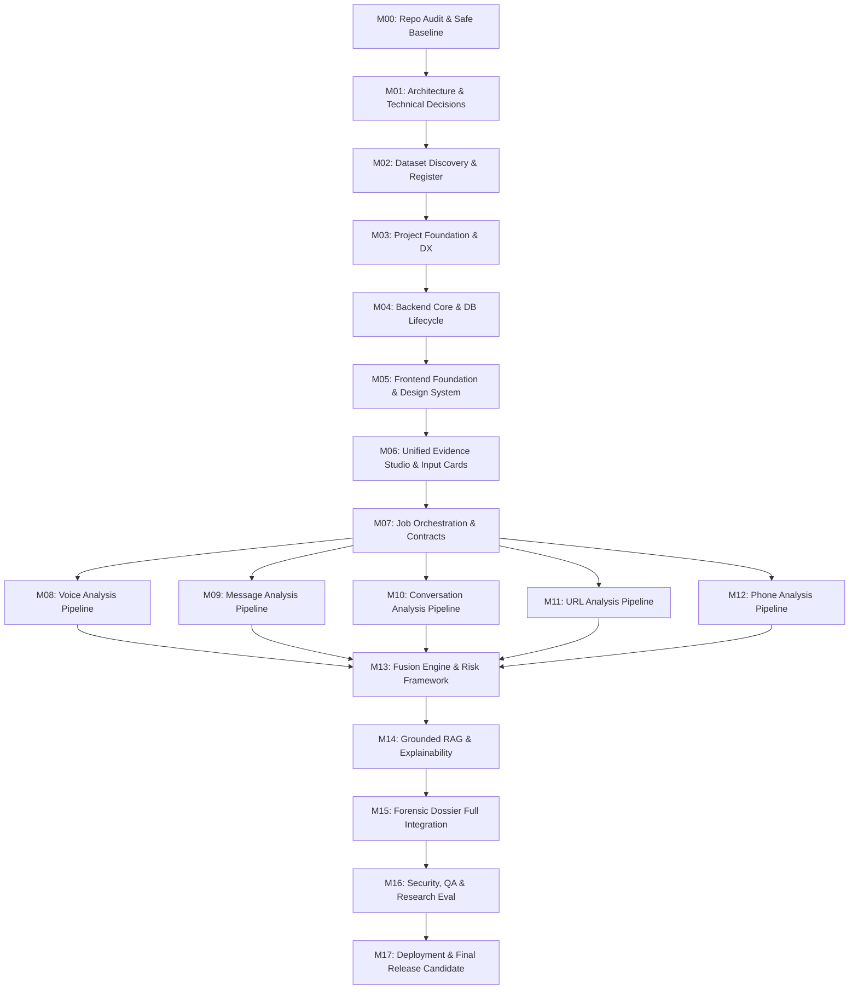

# Repository Audit & Safe Baseline (Milestone M00)
**Project:** Multimodal Impersonation & Fraud Analyzer (AegisAI / Sentinel Core)  
**SRS Version:** 3.0 (Enterprise & High-Innovation Edition)  
**Date of Audit:** November 26, 2026  
**Auditor:** Principal Full-Stack & AI Systems Engineer (Antigravity Agent)  
**Target Integration Branch:** `staging`  
**Feature Branch:** `feature/M00-repository-audit`  

---

## 1. Executive Summary

This document constitutes the formal deliverable for **Milestone M00: Repository Audit and Safe Baseline** for the *Multimodal Impersonation & Fraud Analyzer*.

The objective of M00 is to:
1. Inspect the repository, git configuration, branches, remotes, and local environment.
2. Inventory and preserve all existing user work, source code, scripts, notebooks, datasets, model binaries, and research documents without performing destructive cleanup.
3. Establish robust repository hygiene (a comprehensive `.gitignore` preventing accidental commits of large datasets, audio files, model weights, virtual environments, or secrets).
4. Establish the git branch structure (`staging` integration branch and milestone-specific feature branches).
5. Provide a complete gap analysis and mapping against Software Requirements Specification (SRS v3.0).
6. Formulate the concrete implementation roadmap for Milestones `M01` through `M17`.

---

## 2. Git & Version Control Environment Audit

### 2.1 Repository & Remote Configuration
- **Designated Remote Repository:** `https://github.com/maryam441/Multimodal-Impersonation-and-Fraud-Analyzer.git`
- **Remote Status:** Freshly provisioned remote on GitHub. Initial query (`git ls-remote`) confirmed zero existing commits/branches on remote origin.
- **Local Git State:** 
  - Prior to M00, a `.git` root existed at the user's home directory (`C:/Users/Maryam_Sharif`), leaving the project directory `C:/Users/Maryam_Sharif/Desktop/fyp` untracked.
  - In M00, an isolated git repository was formally initialized in `C:/Users/Maryam_Sharif/Desktop/fyp`, bound to `origin https://github.com/maryam441/Multimodal-Impersonation-and-Fraud-Analyzer.git`.
- **Git User Identity:**
  - `user.name`: `maryam441`
  - `user.email`: `maryam441@users.noreply.github.com`
  - Credential helper: `manager` (Git Credential Manager)

### 2.2 Branch Topology & Workflow Policy
- **Protected Branch:** `main` (Strictly release-only; direct pushes forbidden).
- **Integration Branch:** `staging` (All completed milestone feature branches merge here).
- **Milestone Feature Branch:** `feature/M00-repository-audit` (Active working branch for this milestone).
- **Execution Protocol:** 
  1. Pull latest `staging`
  2. Branch `feature/Mxx-*`
  3. Implement, test, lint
  4. Verify zero data/secret leakage
  5. Merge to `staging`, push remote, verify remote SHA
  6. Stop for explicit user approval before proceeding to `M(xx+1)`

---

## 3. Local Runtime & Dependencies Audit

| Component | Detected Version / Path | Status & Notes |
|---|---|---|
| **Operating System** | Windows 11 (win32, x64) | Active runtime host |
| **Global Python** | Python 3.12.10 | Active; libraries: FastAPI 0.143.1, Uvicorn 0.54.0, Pydantic 2.14.1, SQLAlchemy 2.1.4, Scikit-learn 1.9.1, Pandas 3.0.6, Pytest 9.1.1, Libav/Soundfile |
| **Local Virtual Env (`.venv`)** | Python 3.12.10 (`.venv`) | Active & Functional; includes PyTorch 2.15.0, Torchaudio/Accelerate, HuggingFace Hub 2.4.0 |
| **Legacy Env (`myenv`)** | Missing Python 3.14 target | Deprecated; broken path reference to uninstalled Python 3.14. Preserved on disk, ignored in git. |
| **Node.js Runtime** | Node.js v24.13.0 | Verified; fully compatible with Next.js 15 App Router |
| **Package Manager** | npm 11.6.2 | Verified |

---

## 4. Existing Source Code & Script Assets

All existing user scripts in the workspace have been inspected and preserved without modification:

### 4.1 Voice Modality Scripts
1. **`generate_cleaned_voice_dataset.py` (21.3 KB, 384 lines):**
   - Synthesizes and pre-processes telephony audio recordings simulating realistic Pakistani telecom and vishing fraud channels.
   - Extracts 35 acoustic features: 13 MFCC means, 13 MFCC stds, RMS energy, zero-crossing rate (ZCR), spectral centroid, spectral bandwidth, spectral rolloff, spectral flatness, fundamental frequency pitch ($F_0$), jitter, and shimmer.
   - Simulates telephony channel degradation: 300 Hz – 3,400 Hz 4th-order Butterworth bandpass filter with additive carrier channel noise.
   - Contains 25 custom realistic fraud scripts in Urdu and English covering bank OTP fraud, lottery/prize scams, emergency family kidnapping/accident impersonation, FIA/police intimidation, and PTA biometric SIM block scams.
2. **`train_voice_model.py` (6.0 KB, 160 lines):**
   - Benchmarks four scikit-learn classifiers on the extracted 35 acoustic features:
     - Random Forest Classifier (100 estimators, max depth 10)
     - Gradient Boosting Classifier
     - Support Vector Machine (SVM with RBF kernel, $C=1.0$)
     - Multi-Layer Perceptron (MLP with layers `(64, 32)`)
   - Performs standard scaling (`StandardScaler`) on held-out train/test split.
   - Exports winning model artifacts to `trained_models/best_voice_fraud_model.pkl` and `trained_models/voice_scaler.pkl`.
3. **`predict_voice.py` (8.8 KB, 204 lines):**
   - Standalone CLI inference tool: decodes audio to 16 kHz mono float via PyAV, extracts the 35 acoustic features, applies the saved scaler, and evaluates risk probability.
   - Emits structured indicators (spectral signatures, telephony compression, acoustic perturbation) and safety recommendations.

### 4.2 Utility & Exploratory Scripts
1. **`num.ipynb` (242 KB):**
   - Jupyter notebook containing exploratory scraping and regex extraction of phone numbers, parsing spam complaints from `whoseno.com`.
2. **`agent_runner.py` (5.1 KB, 94 lines):**
   - Air-quality alerting scheduled agent (GAQI); legacy script preserved in workspace as requested by user safety rules.

---

## 5. Dataset Assets & Modality Readiness Audit

The workspace was inspected for existing datasets across all five modalities. The findings are summarized below:

| Modality | Discovered Dataset Files | Size / Volume | Modality Readiness Assessment |
|---|---|---|---|
| **Voice** | `datasets/Cleaned_Voice_Dataset/` - `audio/train/` (80 ham, 80 spam) - `audio/test/` (20 ham, 20 spam) - `voice_features_train.csv` (160 × 45) - `voice_features_test.csv` (40 × 45) - `voice_features_all.csv` (200 × 45) | ~38 MB total 200 audio files 132 Urdu, 28 English | **HIGH READINESS:** Balanced, ground-truth labeled, feature-engineered, and validated. Covers both Urdu and English telecom fraud scenarios. |
| **Message** | `datasets/Dataset_5971.csv` (Columns: `LABEL`, `TEXT`, `URL`, `EMAIL`, `PHONE`)  `datasets/Financial scams detection dataset/Financial scams detection dataset.csv` (Columns: `label`, `message`) | 5,971 SMS samples (596 KB)  523 scam messages (47 KB) | **HIGH READINESS:** Rich SMS dataset covering Roman Urdu and English texts with fraud/ham labels. Ideal for single-message scam classifier with phrase attribution (M09). |
| **URL** | `datasets/PhiUSIIL_Phishing_URL_Dataset.csv`  `datasets/phishing_dataset_1000.xlsx` | 56.8 MB benchmark dataset  1,000 sample dataset (54 KB) | **VERY HIGH READINESS:** The 56.8 MB PhiUSIIL dataset is a world-class academic benchmark for lexical and host URL features. (Must remain local; excluded from git). |
| **Phone** | `phone_dataset/phone_numbers_dataset.csv` `phone_dataset/ham_numbers.csv` `phone_dataset/spam_numbers.csv` | 10 samples (whoseno.com) Small exploratory lists | **LIMITED / FIXTURE ONLY:** Contains only 10 preliminary web-scraped numbers. As per SRS §2, synthetic fixtures + lawful adapter returning `insufficient_data` will be implemented. Real numbers must not be claimed as fraudulent without verified feeds. |
| **Conversation** | *None directly identified* | 0 multi-turn datasets | **GAP DETECTED:** No dedicated multi-turn conversation dataset exists. Multi-turn social engineering must be constructed from synthetic benchmarks or multi-turn dialogues derived from fraud scripts during M02/M10. |

---

## 6. Pre-trained Model Artifacts Audit

Located in `trained_models/` (preserved locally, ignored from git):
- `best_voice_fraud_model.pkl` (174 KB) — Trained Random Forest acoustic model.
- `voice_scaler.pkl` (1.4 KB) — Fitted standard scaler for 35 acoustic features.
- `feature_names.json` (646 Bytes) — Ordered schema of 35 acoustic feature keys.
- `confusion_matrix.png` & `feature_importance.png` — Historical performance plots showing 100% accuracy on the test set.

*Note:* In M08, this pipeline will be formalized into a modular service with cross-validation, speaker/generator disjoint evaluations, and temporal anomaly marking.

---

## 7. Research & Documentation Assets

- **`srs_final_md.md` (58.4 KB):** Master Software Requirements Specification Version 3.0 detailing all functional (FR-01 to FR-18) and non-functional requirements.
- **`2024.lrec-main.422.pdf` (483 KB):** Academic paper from LREC-COLING 2024 detailing SMS spam datasets and linguistic characteristics in South Asian / Roman Urdu communication.
- **`Executive Summary (1).pdf` & `(2).pdf` (328 KB total):** High-level architectural overviews of the multimodal impersonation detection vision.

---

## 8. Security & Git Hygiene Guardrails

To strictly obey the directive: *"verify zero secrets/datasets/model weights are committed"*, a hardened `.gitignore` has been enacted:

1. **Large Datasets Excluded:**
   - `datasets/` (blocks the 56.8 MB URL CSV, audio directories, and raw CSVs)
   - `phone_dataset/`
   - All `*.csv`, `*.xlsx`, `*.parquet`, `*.tar.gz`, `*.zip` outside of approved `tests/fixtures/`
2. **Audio & Media Excluded:**
   - All `*.wav`, `*.mp3`, `*.ogg`, `*.flac`, `*.m4a`
3. **Model Weights & Binary Artifacts Excluded:**
   - `trained_models/`
   - `ml/artifacts/`
   - All `*.pkl`, `*.joblib`, `*.pth`, `*.pt`, `*.onnx`, `*.bin`, `*.model`
4. **Virtual Environments & Dependencies Excluded:**
   - `.venv/`, `myenv/`, `node_modules/`, `.next/`, `build/`, `dist/`
5. **Secrets & Credentials Excluded:**
   - `.env`, `.env.*` (strictly preserving `.env.example`)
   - `*.pem`, `*.key`, `*.cert`, `credentials.json`, `token.json`

---

## 9. SRS v3.0 Gap Analysis & Architectural Alignment

| Requirement Area | Current Repository State | Planned Implementation (Milestone) |
|---|---|---|
| **Frontend UI (Next.js 15, Tailwind, shadcn/ui)** | Not yet initialized | **M05 & M06:** Initialize Next.js App Router, Forensic Precision design system, Evidence Dock, waveform visualizer, defanged URL viewer, and annotated chat thread. |
| **Backend API (FastAPI, PostgreSQL, Redis)** | Standalone offline python scripts | **M03 & M04:** FastAPI modular monolith (`backend/app`), SQLAlchemy 2.0 async ORM, Alembic migrations, case lifecycle endpoints. |
| **Voice Modality** | Baseline scripts & features ready | **M08:** Modular FastAPI service + PyTorch deep-learning spoof detector with temporal anomaly segment scoring. |
| **Message Modality** | 5,971 sample dataset located | **M09:** TF-IDF + Logistic Regression/SVM baseline + Transformer NLP pipeline with token-level phrase attribution for Roman Urdu & English. |
| **Conversation Modality** | No multi-turn data | **M10:** Turn-level social-engineering parser (`[Urgency]`, `[Authority]`, `[OTP/Money]`, `[Channel Switch]`) with synthetic validated fixtures. |
| **URL Modality** | 56.8 MB PhiUSIIL dataset located | **M11:** URL structural anatomy deconstruction (`hxxp://`) + lexical/host ML classifier + defanged UI card. |
| **Phone Modality** | 10 preliminary web-scraped entries | **M12:** E.164 normalization, carrier/region structural checks, and provider adapter returning `insufficient_data`/`unavailable` for unverified numbers. |
| **Multimodal Fusion Engine** | Not implemented | **M13:** Transparent weighted late-fusion baseline with missingness handling and boundary-tested 0–100 risk scoring. |
| **Explainable RAG Assistant** | Not implemented | **M14:** Grounded decision-support assistant with deterministic citations and human-in-the-loop approval gates. |
| **Interactive Forensic Dossier** | Not implemented | **M15:** Command center UI connecting all five modalities, radial risk gauge, constellation graph, and one-click report purge. |

---

## 10. Proposed Implementation Plan & Next Steps

### Immediate Action Required
Milestone `M00` is ready for review. All files have been audited, git safety policies have been applied, and the audit deliverable has been prepared.
Upon user approval, `feature/M00-repository-audit` will be merged to `staging`, pushed to remote, and `M01` will commence.
